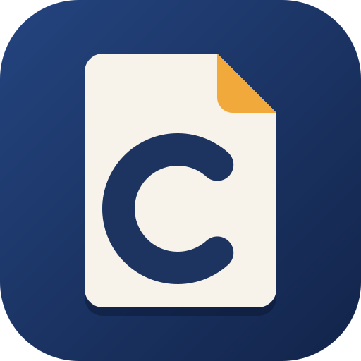

# CleonPDF app icon



**Motif:** a sheet of paper with its top-right corner folded down, and a bold C (for Cleon) open to the
right. It is drawn from plain shapes, so it stays legible at 16 px.

**Palette:**

| Colour | Hex | Used for |
|---|---|---|
| Navy (app colour) | `#24447f` → `#12244a` | the full-bleed field (a diagonal gradient) |
| Paper | `#f7f3ea` | the page |
| Amber | `#f2a93b` | the folded corner |
| Ink navy | `#1d3461` | the C |

**Tile:** `viewBox="0 0 512 512"`, a rounded square with `rx=112` that clips everything. Windows and Linux
icons use the full-bleed tile. macOS icons put it on Apple's grid (an 824 px body centred on a transparent
1024 px canvas).

**Provenance:** original artwork made for CleonPDF, written by hand as SVG (no fonts, images or third-party
material). Licence: [LICENSE.txt](LICENSE.txt) (`MIT OR Apache-2.0`, like the repo). CleonPDF's icon
replaces PdfCraft's; the two share only the tile geometry.

## Files

| File | What it is |
|---|---|
| `cleonpdf.svg` | the master vector; every PNG, `.ico` and `.icns` is rendered from it |
| `cleonpdf-small.svg` | a copy of the master, kept for places that link to it, such as this README |
| `cleonpdf-1024.png` | 1024 px on Apple's grid; also the runtime Dock icon on macOS |
| `cleonpdf.icns` | macOS icon (16–1024 px) |
| `cleonpdf.ico` | Windows icon (16–256 px), embedded in `cleonpdf.exe` by `apps/cleonpdf/build.rs` |
| `cleonpdf-document.svg` | Windows PDF file icon master: a Lucide document outline, navy badge and outlined PDF lettering; no font dependency |
| `cleonpdf-document.ico` | Windows PDF file icon (16–256 px), embedded as resource 2 in `cleonpdf.exe` |
| `hicolor/<n>x<n>/apps/io.github.kristianrama.cleonpdf.png` | Linux hicolor theme, 16–512 px; the 256 px one is the runtime icon on Windows and Linux |
| `hicolor/scalable/apps/io.github.kristianrama.cleonpdf.svg` | Linux scalable icon (copy of the master) |

Where it shows: `apps/cleonpdf/src/main.rs` sets the window icon (Dock, taskbar, Alt-Tab, launcher) and the
Wayland app id `io.github.kristianrama.cleonpdf`; `packaging/linux/io.github.kristianrama.cleonpdf.desktop` names the
hicolor icon.

Windows PDF files use resource 2 (`"cleonpdf.exe",-2`) when CleonPDF is chosen as the default
reader; the app keeps resource 1. The document outline is adapted from Lucide `file-text`
1.49.0 (ISC); its badge and outlined lettering are original (`MIT OR Apache-2.0`), covered by
[LICENSE-document.txt](LICENSE-document.txt). Both icons are embedded, requiring no runtime
sidecar. This provides a file type icon; first-page thumbnails still need a thumbnail provider.

## Regenerate

```sh
packaging/icons.sh        # needs resvg and python3 (iconutil on macOS is used when present)
cargo xtask assets        # then update the sha256 values in ATTRIBUTION.toml and run with --write
```
