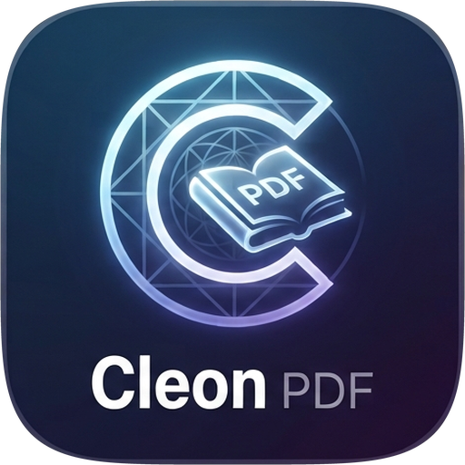

# CleonPDF app icon



**Artwork:** a glowing C, drawn over a geometric sphere, around an open book marked "PDF", above the
"Cleon PDF" wordmark, on a dark blue-to-violet tile with a light rim. Supplied by the project owner,
Kristian Rama, on 2026-10-14 as a 1408 × 768 mockup; the icon tile in it is about 474 px wide.

**Two raster masters**, both 512 px (the artwork's own resolution, so nothing is invented by upscaling):

- `cleonpdf.png`: the whole tile, for every size from 64 px up.
- `cleonpdf-small.png`: the emblem alone (the C and the book) on the same tile shape, for sizes below
  64 px, where the wordmark would only be a smudge.

**How they were cut from the mockup:** the tile is the box x 467–940, y 140–621 (its rim included),
scaled to a square; the emblem is the 322 px square centred on (693, 333). Both are masked with the
tile's own corner shape, a superellipse |x|ⁿ + |y|ⁿ = 1 with n = 4.9, fitted to the rim and drawn
half a pixel inside it so none of the mockup's background shows. The mockup itself (with other
software's logos around the icon) is not committed.

**Tile:** Windows and Linux icons use the full-bleed tile. macOS icons put it on Apple's grid (an
824 px body centred on a transparent 1024 px canvas).

Licence: [LICENSE.txt](LICENSE.txt) (`MIT OR Apache-2.0`, like the repo).

## Files

| File | What it is |
|---|---|
| `cleonpdf.png` | master, 512 px: the full tile; every icon of 64 px and up is made from it |
| `cleonpdf-small.png` | master, 512 px: the emblem alone; every icon below 64 px is made from it |
| `cleonpdf-1024.png` | 1024 px on Apple's grid; also the runtime Dock icon on macOS |
| `cleonpdf.icns` | macOS icon (16–1024 px) |
| `cleonpdf.ico` | Windows icon (16–256 px), embedded in `cleonpdf.exe` by `apps/cleonpdf/build.rs` |
| `cleonpdf-document.svg` | Windows PDF file icon master: a Lucide document outline, navy badge and outlined PDF lettering (vector, unchanged by the raster artwork); no font dependency |
| `cleonpdf-document.ico` | Windows PDF file icon (16–256 px), embedded as resource 2 in `cleonpdf.exe` |
| `hicolor/<n>x<n>/apps/io.github.kristianrama.cleonpdf.png` | Linux hicolor theme, 16–512 px; the 256 px one is the runtime icon on Windows and Linux |

Where it shows: `apps/cleonpdf/src/main.rs` sets the window icon (Dock, taskbar, Alt-Tab, launcher) and the
Wayland app id `io.github.kristianrama.cleonpdf`; `packaging/linux/io.github.kristianrama.cleonpdf.desktop` names the
hicolor icon.

Windows PDF files use resource 2 (`"cleonpdf.exe",-2`) when CleonPDF is chosen as the default
reader; the app keeps resource 1. The document outline is adapted from Lucide `file-text`
1.49.0 (ISC); its badge and outlined lettering are original (`MIT OR Apache-2.0`), covered by
[LICENSE-document.txt](LICENSE-document.txt). Both icons are embedded, requiring no runtime
sidecar. This provides a file type icon; first-page thumbnails still need a thumbnail provider.

## Regenerate

```sh
packaging/icons.sh        # needs python3 with Pillow, and resvg for the document icon
cargo xtask assets        # then update the sha256 values in ATTRIBUTION.toml and run with --write
```
